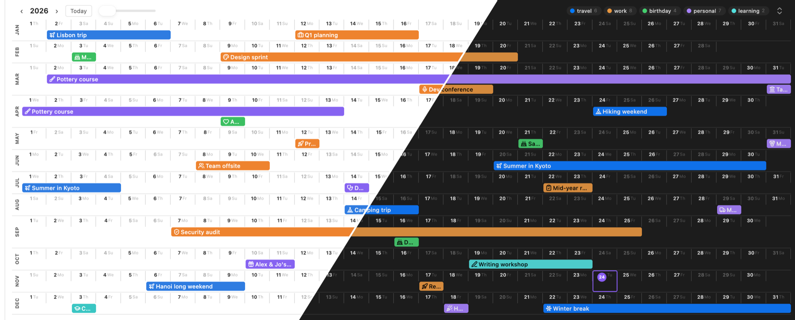
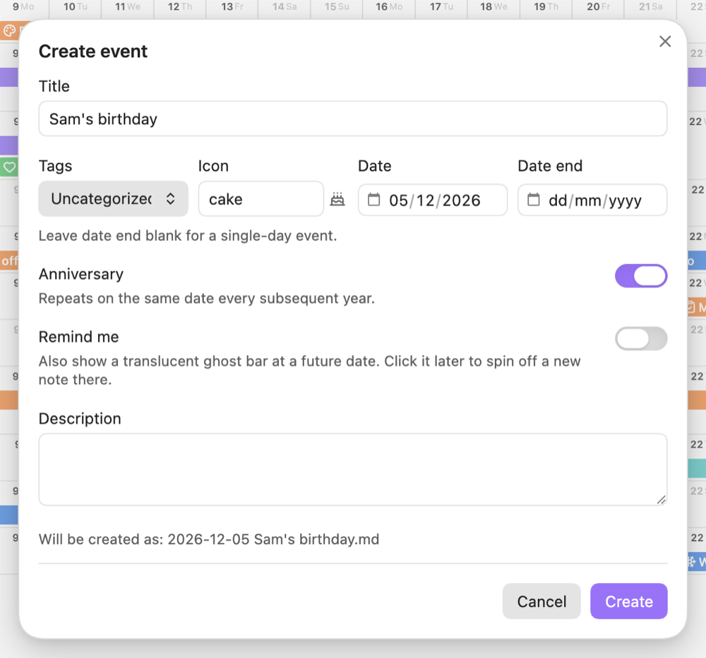

# Linear Calendar

**Your whole year on one screen.** A horizontal year-at-a-glance timeline for your notes: any note with a start date in its frontmatter becomes a bar, grouped and coloured by tag. Drag a bar to reschedule it.



## Quick start

Run **Linear Calendar: Open** from the command palette. The fastest way to see it work is to right-click a day and choose *Create event*: that makes a note for you, with nothing to set up first.

To put notes you already have on the calendar, add frontmatter:

```yaml
---
tags: [linear-calendar/work]
datestart: 2026-03-10
dateend: 2026-03-14
icon: briefcase
---
```

### What puts a note on the calendar

1. **A `linear-calendar` tag.** Either `linear-calendar` or a subtag such as `linear-calendar/work`, in frontmatter or inline (`#linear-calendar/work`). The subtag is the note's category and sets its colour.
2. **A start date**, as `YYYY-MM-DD`, in `datestart`.
3. **Optionally**, an end date in `dateend` and an icon name in `icon`. Without an end date the note is a single-day marker.

A note that misses the first two is left out without a warning, so check them first when something doesn't appear. An end date that comes before the start, or one that can't be read, is treated as a single day.

The property names are the defaults. If your notes already use others, change them under *Frontmatter properties* in settings.

## Do it all from the calendar

You rarely need to open a note to manage it. Everything below happens on the timeline itself, and the plugin writes the result back to each note's frontmatter.

- **Drag to reschedule.** Drag a bar to a new date, or drag its edges to change how long it lasts. For notes made with the Create event command, the date at the start of the filename is renamed to match.
- **Right-click a day to create an event.** A form asks for the title, tag, icon, start and end date and a description, then makes the note in the folder you chose, with an optional Templater template. If the day has no daily note yet, the same menu offers to create one.
- **Right-click a bar to edit it.** *Edit event* opens the same form, filled in. The menu also opens the note, opens it in a new tab, or copies a link to it.
- **Repeat events every year.** Switch on *Anniversary* and the event comes back on the same date each year, drawn with a dashed border. A birthday (tag `linear-calendar/birthday`) shows the age it turns on later years.
- **Remind yourself.** *Remind me* adds a translucent ghost bar at a later date. Click it when the time comes to start a new note there.
- **Filter by tag.** Click a tag chip above the timeline to hide or show everything under it.



## Features

- **Year timeline.** All twelve months as rows, each note a bar from its start date to its end date (single-day notes get a point marker). Switch the columns between calendar date and weekday.
- **Colour and icon by tag.** Notes are grouped by their `linear-calendar/*` subtag. Each tag takes one of the theme's eight hues (or grey), so colours follow your theme and light or dark mode. Tags take the hues in order, or click a tag in the settings tab to choose its hue and a Lucide icon. Colours saved by an older version move to the nearest hue the first time this one loads.
- **Hover tooltips** with the title, date range and an optional description.
- **Daily note markers.** Days with an existing daily note are tinted or underlined, in the colour and style you pick.
- **Your own frontmatter.** Every property name (title, start and end date, icon, anniversary, reminder, description) can be remapped in settings, so it works with the schema you already have.

## Settings at a glance

Most people only touch two of these, *New event* and *Frontmatter properties*.

| Section | What it does | Change it when |
| --- | --- | --- |
| Tag hues | Click a tag to pick its hue and icon, or add a tag | you want a category to look a certain way |
| Appearance | Line months up by date or by weekday, set the fonts, optionally show weekdays as kanji | you want a different look |
| Daily notes | Colour and style of the mark on days that have a daily note | you use daily notes |
| New event | The folder, filename date format and optional Templater template for notes made from the calendar | before you create events, because it decides where they land |
| Frontmatter properties | Which properties hold the title, dates, icon, anniversary flag, reminder and description | your notes already use other property names |

On the timeline, the left and right arrow keys change the year and **T** jumps back to today.

## Disclosures

- **Network use:** none. The plugin makes no network requests.
- **File access:** reads frontmatter from notes across the vault to build the timeline. It writes to a note only when you drag or resize its bar (new dates in the frontmatter, and the filename's date prefix for notes made with the Create event command) or when you use the Create event command (a new note in the folder you set).
- **Accounts, telemetry, ads and third-party services:** none.
- **Optional integration:** if the Templater plugin is installed and you set a template, new event notes are rendered through it.

## Installation

Not on the community plugin store. Either:

- **Manual:** download `main.js`, `styles.css`, and `manifest.json` from a [release](https://github.com/lhak1341/obsidian-linear-calendar/releases) into `<vault>/.obsidian/plugins/lhak-linear-calendar/`, then enable it in Obsidian's Community Plugins settings.
- **BRAT:** add this repo to [Obsidian42 - BRAT](https://github.com/TfTHacker/obsidian42-brat) as a beta plugin.

Desktop only.

## Development

```bash
bun install
bun run check   # typecheck, lint and tests
bun run build   # production bundle to main.js
bun run deploy  # check, build, then copy into the configured vaults
```

See [CLAUDE.md](./CLAUDE.md) for architecture notes and other gotchas if you're working on this plugin.

## License

MIT
